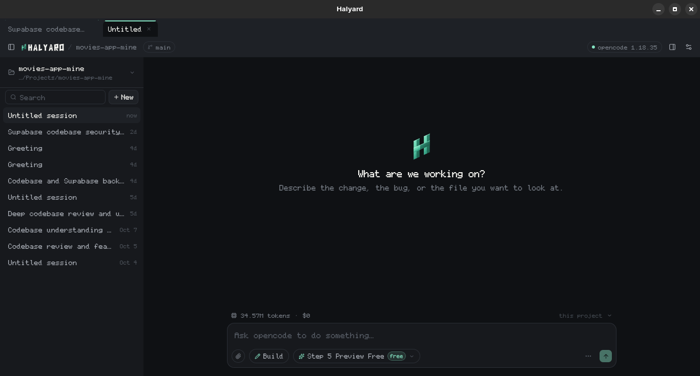

<div align="center">

<picture>
  <source media="(prefers-color-scheme: dark)" srcset="docs/lockup-on-dark.svg">
  
</picture>

# Halyard

**A native desktop shell for [opencode](https://opencode.ai).**

Chat, session tabs, subagents, diffs and settings — with opencode's own server
started, watched and stopped for you.

[](LICENSE)
[](https://tauri.app)
[](https://tauri.app)
[](https://react.dev)
[](https://www.rust-lang.org)

</div>

---



## What it does

- **Sessions** — tabs, branching, forking, sharing, export and import through
  opencode's own CLI, scoped to the project you have open
- **Subagents** — delegated runs appear as nested sessions under their parent
- **Diffs** — per-file review, inline with the tool that made the change
- **Plan** — the agent's todo list, live above the composer
- **Skills** — search and attach several at once, then send them as commands
- **Permissions and questions** — answered inline, without leaving the thread
- **Context meter** — the live prompt window, not a lifetime token tally
- **Tray** — close to tray, notifications when a turn finishes, taskbar badge
- **Settings** — providers, models, agents, MCP servers, skills and opencode's
  own config, all live

## Getting started

You need [Node](https://nodejs.org), [pnpm](https://pnpm.io), a Rust
toolchain, and `opencode` on your `PATH` — or a path to it in Settings.

```bash
git clone https://github.com/12errh/halyard.git
cd halyard
pnpm install
pnpm tauri dev
```

Build a distributable bundle:

```bash
pnpm tauri build
```

## Testing

```bash
pnpm verify   # typecheck, frontend tests, Rust tests, production build
pnpm smoke    # the fast loop: shell smoke test + architecture guard
```

`pnpm verify` is what CI runs on every push. See
[docs/testing.md](docs/testing.md) for the layers and the rules behind them —
in short, unit tests do not catch a component that crashes on mount, so
something mounts the real shell.

## How it fits together

| Layer | What lives there |
|---|---|
| `src-tauri/` | Rust. Spawns and supervises the opencode server, tray, notifications, taskbar attention, and the settings file |
| `src/lib/opencode/` | The opencode client: HTTP, the SSE stream, and the pure thread reducer |
| `src/state/` | Zustand stores, one per concern — sessions, threads, permissions, models, settings |
| `src/components/` | The UI: `shell/` for the window, `chat/` for the conversation |
| `tools/` | The mark and wordmark, defined once as geometry and rendered to every icon |

The rule that shapes most of `src/lib/opencode/`: streaming correctness is
derived as a pure function of `(state, event)` with no I/O and no React, so it
can be tested exhaustively instead of watched.

## The mark

An isometric **H** drawn from sheared parallelograms — a line that becomes a
letter, a symbol and a sense of direction. Each stroke splits along its centre
into two facets meeting at a fold, so it reads as a folded ribbon rather than a
flat letter, and still reads as an H when both facets collapse to one colour.

The wordmark is custom geometric lettering, not a typeface — every horizontal
band is cut so its top and bottom edges rise to the right at the mark's own
angle, and no other angle is allowed anywhere in the word. The word itself stays
flat and level so it holds together at the eleven pixels the title bar gives it.

<p align="center">
  <picture>
    <source media="(prefers-color-scheme: dark)" srcset="docs/wordmark-on-dark.svg">
    
  </picture>
</p>

| | |
|---|---|
|  |  |

| Colour | Hex | Role |
|---|---|---|
| Graphite | `#17191D` | Surface, and the mark in light mode |
| Seafoam mint | `#83E1C1` | Accent |
| Soft white | `#F4F4F0` | Ink, and the mark on graphite |

Both are defined once as geometry — [`tools/logo.py`](tools/logo.py) for the
symbol, [`tools/wordmark.py`](tools/wordmark.py) for the word — and everything
else is generated from them: app icons, tray icon and the lockups. Run
`bash tools/icons.sh` after changing either and commit the result under
`src-tauri/icons`.

## Platforms

Linux and Windows. The server is terminated with SIGTERM on Unix and
`taskkill /T` on Windows, so the child process never outlives the window.

## Licence

MIT — see [LICENSE](LICENSE).
